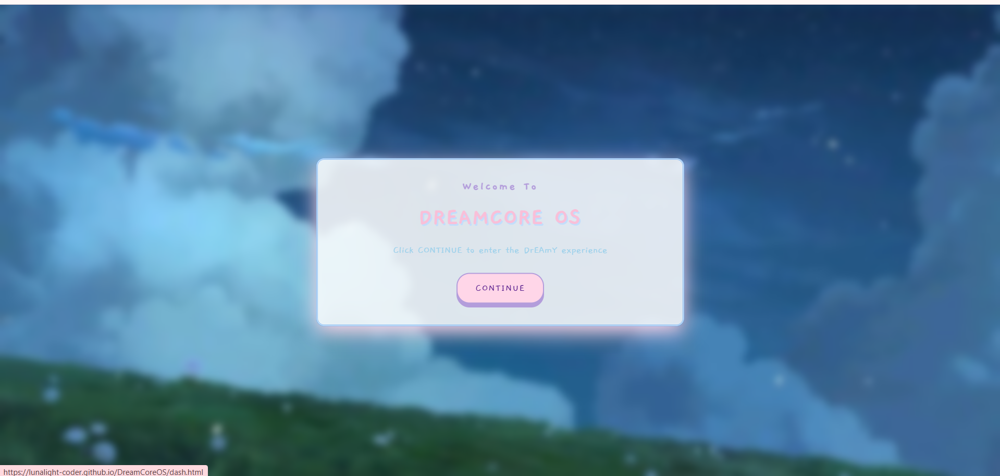
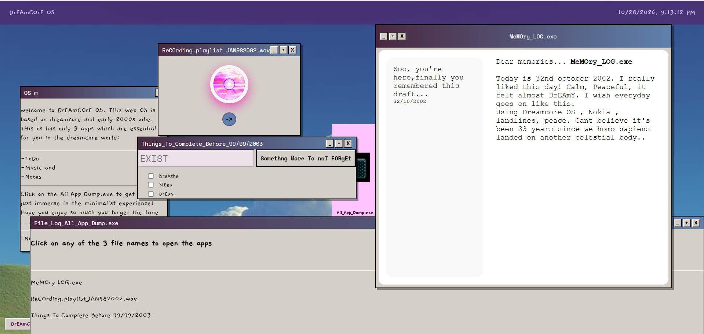
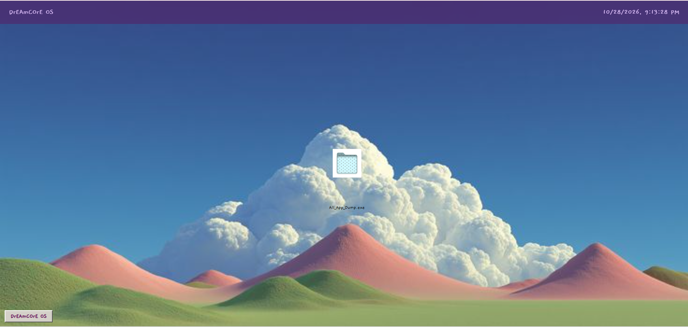

# DreamcoreOs

An Dreamcore themed minimalist WEB OS.

### Try The Website:
**[Quick start: Click here to open the demo](https://lunalight-coder.github.io/DreamCoreOS/)**

### Guide:
To use the OS, follow the given steps:
1. Click on the demo link.
2. You will get a message asking you to click anywhere on the screen. Click anywhere in the window, then a pop-up box will appear (make sure to turn on the volume) and click continue.
3. The main Web OS window will appear. Click on the Dreamcore OS button at the bottom of the screen, you will be guided to the next steps by the OS itself.

### Core-features:

#### I- Apps:
All apps are contained in a single folder icon to align with the minimalist theme. The guide for these apps is in the same window.

1. **Notes (Memory_log.exe):** This App is a minimalist version of a normal notes app with default text to make the experience more immersive. The default text can be changed by the user, and it can be used as a normal, functional notes app.
2. **Music (ReCOrding.playlist_JAN982002.wav):** This is designed to provide a nostalgic CD player music experience. The user can click on the CD to stop/start the music, which keeps on playing in the background even after the window is closed.
3. **ToDo (Things_To_Complete_Before_99/99/2003):** A basic To Do list app with minimalist styling. It allows the user to enter and check-off tasks which are completed.

#### Additional Information:
* **Background-music:** The WEB OS has a default background music which plays as soon as you start interacting with the site.
* **Draggable windows:** The windows are draggable and can be put one over another.
* **Window functions:** Windows can be stacked on other windows, maximized, and removed. The minimize and X button perform the same function.
* **Unique experience:** The OS is designed to be a place on the internet to bring back the 2000s style. Offering minimal, peaceful features to reduce distractions!

***

`[AI disclosure: I honestly disclose that i 'did' use AI but ONLY for debugging and minor refinement. I made sure to make my custom changes, edits, and styling to the code to be as creative as possible.]`
